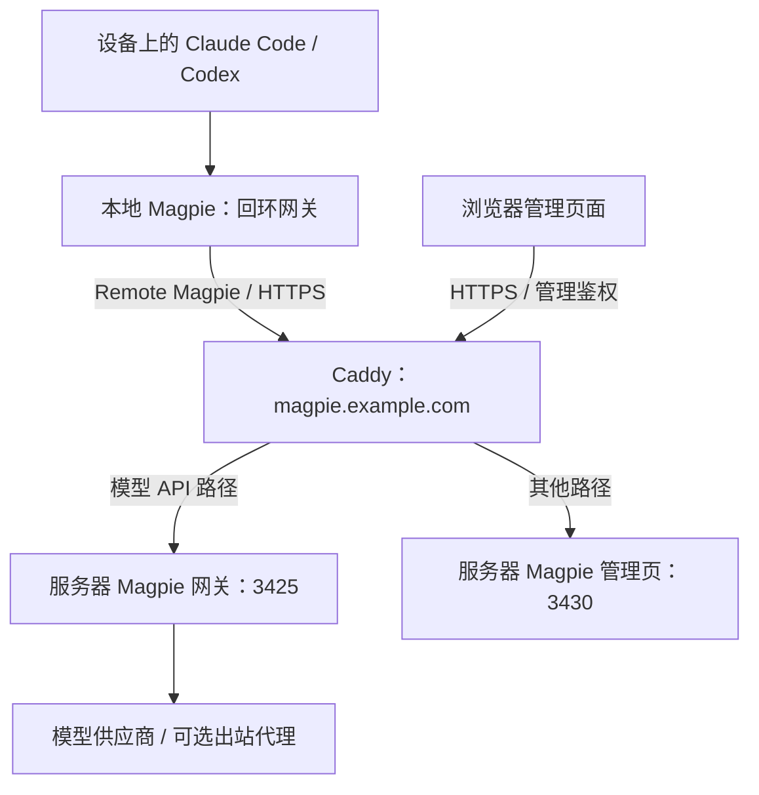

# Magpie 服务器部署实践：多设备共用一个模型网关

## 部署背景

我日常会在多台设备上使用 Claude Code 和 Codex。在[模型路由实践](./Magpie%20模型路由实践.md)中，我的账号组合包括 Claude 和 ChatGPT 两个固定订阅、agy、按需补充的 GPT 临时账号，以及一个应急中转；路由按 plan、build、review、light 四组划分。

这套配置最初只在本地 Magpie 中维护。换一台设备，账号授权、模型目录和路由组都要重新整理一遍；部分供应商还会轮换刷新令牌，同一账号在多台设备上登录时，一端刷新后另一端的凭据可能失效。此前使用 Cockpits 时也是这样，每台设备各自维护账号状态。

因此，我把 Magpie 部署到 VPS：服务器持有账号、provider 和路由配置，设备上的本地 Magpie 通过 Remote Magpie 接入远端，为 Claude Code 和 Codex 提供本机入口。账号授权和模型分工都只维护一份。

- 官网：<https://usemagpie.ai>
- 代码仓库：[yetone/magpie](https://github.com/yetone/magpie)

本文记录截至 **2026-10-22** 的部署配置。服务器 Magpie 已从 **v0.1.1307** 升至 **v0.1.1318**，本地为 **v0.1.1318**，Caddy 为 **2.11.7**。示例中的域名、账号和目录均已替换。这是单机部署，未覆盖高可用，也未完成全部故障场景的验收。

如果只在一台设备上使用，本地 Magpie 已经足够，无需部署服务器。集中部署带来的是多设备一致性，代价是新增服务器、证书、备份和远端账号的维护工作。

## 1. 整体架构与两段网络连接



整条链路分为两段：设备访问 VPS，VPS 访问模型供应商。设备侧的网络代理不决定服务器请求的出口；服务器侧的代理设置，也不影响设备浏览器中的 OAuth 登录流量。

这台服务器上另有一套独立的设备代理服务，Magpie 的上游请求不经过它。两者流量路径互不依赖，排查时应分别检查。

## 2. Docker Compose 部署：后端仅发布到回环地址

部署由两个 Compose 项目组成：Magpie 提供应用，Caddy 负责 HTTPS 入口。Magpie 部分如下：

```yaml
services:
  magpie:
    image: ghcr.io/yetone/magpie:latest
    restart: unless-stopped
    ports:
      - "127.0.0.1:3425:3425"
      - "127.0.0.1:3430:3430"
    environment:
      MAGPIE_WEB_KEY: ${MAGPIE_WEB_KEY:?请设置管理密钥}
      MAGPIE_NO_STATS: "1"
      MAGPIE_WEB_URL: https://magpie.example.com
      MAGPIE_PUBLIC_URL: https://magpie.example.com
      HTTP_PROXY: ${MAGPIE_PROXY:-}
      HTTPS_PROXY: ${MAGPIE_PROXY:-}
      ALL_PROXY: ${MAGPIE_PROXY:-}
    volumes:
      - magpie-config:/config
    command: ["web", "--addr", "0.0.0.0:3430", "--no-open"]

volumes:
  magpie-config:
```

对应的 `.env` 结构如下，示例值均需替换：

```dotenv
MAGPIE_WEB_KEY=<replace-with-a-long-random-management-key>
# 不需要代理时留空；需要时填写有效代理，认证信息需要 URL 编码。
MAGPIE_PROXY=
```

填入实际值后，校验并启动：

```bash
chmod 600 .env
docker compose config -q
docker compose up -d
docker compose ps
```

`config -q` 只做校验，不输出内容。直接输出解析后的完整配置，会把代理密码等变量展开到终端或日志中。

这份配置有三点需要注意：

- 容器内部监听 `0.0.0.0`，宿主机端口发布到 `127.0.0.1`，两者并不冲突。是否暴露到公网，取决于宿主机的端口发布和网络规则。
- `/config` 保存账号、provider 和路由等状态。只保留镜像和 Compose 文件，无法恢复完整服务。
- 这里使用官方正式版 `latest` 标签，配合第 11 节的定时更新流程。标签本身不会触发升级；若需要逐版审核，也可以固定版本号或 digest。

## 3. Caddy 单域名 HTTPS 与路径分流

Magpie 使用两个端口，但对外只需要一个域名，3425 和 3430 也无需在公网开放。Caddy 按路径分流：

| 公网路径 | 后端 |
| --- | --- |
| `/v1`、`/v1/*` | 模型网关 3425 |
| `/v1beta`、`/v1beta/*` | 模型网关 3425 |
| 其他路径 | 管理页面 3430 |

对应的 Caddyfile 示例：

```caddyfile
{
    auto_https disable_redirects
    servers {
        protocols h1 h2
    }
}

magpie.example.com {
    tls {
        issuer acme {
            disable_tlsalpn_challenge
        }
    }

    header Cache-Control "no-store"

    @gateway path /v1 /v1/* /v1beta /v1beta/*
    handle @gateway {
        reverse_proxy 127.0.0.1:3425
    }

    handle {
        reverse_proxy 127.0.0.1:3430 {
            header_down Set-Cookie "(.*)" "$1; Secure"
        }
    }
}
```

这份配置使用 HTTP-01 签发证书，禁用 TLS-ALPN challenge，协议限制为 h1/h2。服务器上已有 Caddy 时，应合并站点配置，不要用示例覆盖其他站点。

Caddy 的 Compose 示例：

```yaml
services:
  caddy:
    image: caddy:2.11.7
    restart: unless-stopped
    network_mode: host
    volumes:
      - ./Caddyfile:/etc/caddy/Caddyfile:ro
      - ./data:/data
      - ./config:/config
```

示例面向 Linux VPS。Caddy 使用 host network，因此可以访问宿主机回环地址上的 Magpie；若改用默认的 bridge 网络，容器内的 `127.0.0.1` 指向 Caddy 容器自身，需要重新设计后端连接方式。

域名解析指向 VPS，本次使用 DNS-only 模式。公网 TCP 443 承载业务流量，TCP 80 保留给 HTTP-01 验证。证书签发成功不等于自动续期已经实测通过；反过来，平时没有服务常驻监听 80 端口，也不能据此判断续期会失败。

修改配置后，先校验再热重载：

```bash
docker compose exec -T caddy \
  caddy validate --config /etc/caddy/Caddyfile

docker compose exec -T caddy \
  caddy reload --config /etc/caddy/Caddyfile
```

以上命令适用于已在运行的 Caddy。首次启动前，可以先执行 `docker compose run --rm caddy caddy validate --config /etc/caddy/Caddyfile`，校验通过后再 `docker compose up -d`。

### 路径前缀与转发范围

模型网关需要完整的 `/v1` 前缀，因此这里使用 `handle`。如果换成会剥离匹配前缀的 `handle_path`，原本正确的请求可能在后端返回 404。

也不要把 `/api/*` 整体转发到模型网关，它与管理 API 的路径存在重叠。本次没有在公网发布 Ollama 兼容接口。转发 `/v1beta/*` 只表示路径覆盖了 Gemini 协议入口，不能代替一次真实的 Gemini 调用验证。

## 4. 管理密钥与网关密钥分离

同一个域名下，管理权限和调用权限仍然分开：

| 凭据 | 用途 |
| --- | --- |
| 管理密钥 | 登录管理页面，维护账号、provider 和路由 |
| 网关密钥 | 客户端访问模型接口 |
| 上游账号或 API Key | 服务器访问模型供应商 |

`MAGPIE_WEB_KEY` 是管理密钥。网关密钥需要通过管理页面，或当前版本提供的 gateway-key 命令单独创建，不能用管理密钥代替。

本次对两个方向都做了验证：管理密钥无法调用网关，网关密钥无法进入管理页面。使用正确的网关密钥访问模型目录返回 200；密钥错误、缺失或类型不对时返回 401。

管理页面登录后使用浏览器 Cookie，检查确认带有 HttpOnly 和 Secure 属性。这个 Cookie 仍属于高权限凭据，不应提供给模型客户端，也不应出现在文章、截图或日志中。书签只保存不含认证参数的管理地址，登录时通过表单输入密钥。

排查 401 时，先确认请求到达的是哪个入口、使用的是哪类密钥。未认证访问管理入口返回 401 属于正常防护，不代表服务故障或上游账号失效。

## 5. 出站代理与住宅出口

如果服务器需要经住宅代理访问上游，可以在 `.env` 中配置：

```dotenv
MAGPIE_PROXY=socks5h://<encoded-user>:<encoded-password>@proxy.example.com:1080
```

`socks5h` 表示由代理解析目标主机名，实际是否生效取决于各个调用库的实现。它不能保证所有 DNS 查询、IPv6、SDK 和子进程请求都经过代理。

本次环境中，容器内的 HTTP 出口查询经住宅代理返回成功。但需要明确：**环境变量只是默认配置，不是网络层的强制隔离**。

- 上面的 Compose 允许 `MAGPIE_PROXY` 为空，留空时服务照常启动，请求直连。
- provider 或账号级别的代理设置可能覆盖默认值。
- 子进程和 SDK 对代理环境变量的处理方式不一定一致。
- 设备浏览器中的 OAuth 页面走设备自己的网络。

Claude 订阅需要单独确认。缓存源码中有一条路径在为 Claude Code 同步账号代理时，只接受 HTTP/HTTPS 代理，遇到 SOCKS 会直接省略。不过，这份缓存源码与服务器运行的镜像没有建立完整的版本对应关系，也不能代表 Magpie 中所有的 Claude 调用路径。

后续一次连接快照显示：Claude 进程连接的是回环地址，Magpie 进程存在到住宅代理的连接。但快照没有覆盖完整的请求过程，进一步检查也没有取得可确认的请求目标。因此，**Claude 订阅流量是否完整经由住宅出口，目前仍是待验证项**，既不能认定已经绕过代理，也不能认定绝不直连。

如果实际路径只支持 HTTP 代理，可以考虑使用供应商提供的 HTTP 代理，或在本机增加 HTTP CONNECT 到 SOCKS 的转换层。是否需要这一步，应在确认真实调用路径之后再决定，本次没有新增组件。

## 6. 服务器端账号授权与路由配置

服务器上的账号应在服务器侧完成授权，不要把本地登录文件复制过去，让两端长期共用同一份凭据。

部分供应商会轮换刷新令牌，一端刷新后，另一份旧凭据可能随之失效；有些导入流程本身就会触发刷新，影响原工具的登录状态。同理，备份中的账号状态也可能过期，恢复旧文件不一定能恢复登录。

授权时浏览器在设备上，授权进程在 VPS 的容器里，localhost 回调通常无法直接到达。使用当前版本提供的回调地址粘贴机制即可，不需要为一次授权长期开放额外端口。回调 URL 可能包含一次性授权信息，同样不要公开。

账号就绪后，在服务器端建立路由组，分组与规则参考[模型路由实践](./Magpie%20模型路由实践.md)。路由组只建在服务器一侧，设备端不需要再建一套同名组。

路由保存成功不代表账号权限已经就绪。模型目录、实际生成、流式响应、工具调用和令牌刷新，需要分别检查。

## 7. 设备端接入 Remote Magpie

设备上仍然运行本地 Magpie，并添加一个 Remote Magpie provider，填入服务器地址和网关密钥。假设本地将其命名为 `remote`，模型目录中会出现：

```text
remote/group/qianfan
remote/group/qianfan-plan
remote/group/qianfan-build
remote/group/qianfan-review
remote/group/qianfan-light
remote/group/qianfan-emergency
```

设备上的 Claude Code 和 Codex 连接本地 Magpie，由它转发到远端。`group/qianfan` 指向本地组，`remote/group/qianfan` 才是远端组。

如果客户端直接连接服务器网关，Base URL 的常见写法是：

- OpenAI 兼容客户端：`https://magpie.example.com/v1`。
- Anthropic 兼容客户端：按客户端要求填写站点根地址，由客户端追加 API 路径。

不同客户端拼接 Base URL 的方式不同，配置后应检查实际请求路径，避免重复追加 `/v1`。

### 本地配置的收敛顺序

接入远端后，我让本地只保留远端连接，按以下顺序清理：

1. 备份本地 Magpie、主客户端和子代理配置。
2. 确认远端组可见，并完成一次实际调用。
3. 将主会话、模型选择器和子代理的引用全部改为远端组。
4. 关闭账号自动发现：`magpie accounts discovery off`。
5. 移除本地组、已保存账号和不再使用的本地 provider，保留远端连接。
6. 再次核对目录，并实际生成一次。

第 3 步需要在删除本地组之前完成。本次清理时，两个客户端共有六个子代理仍引用本地组，若先删组，这些引用就会失效。

第 4 步同样必要：本机原生工具仍处于登录状态时，未关闭自动发现的 Magpie 可能重新识别出这些账号。账号移除的具体语义因版本而异，优先使用当前版本支持的管理页面或命令；如需直接编辑配置文件，先确认结构并完成备份，避免运行中的进程覆盖修改。

本次清理的只是 Magpie 保存的账号记录，没有退出厂商原生应用的登录，也没有在厂商侧撤销授权。备份中的旧凭据仍属于敏感信息，界面上不再显示账号，不代表凭据已经销毁。

## 8. 交给 Agent 执行部署

与路由配置一样，部署也可以交给 Agent 执行。前面的配置用于说明结构和检查要点，实际操作时，可以把本文和下面的要求一起交给 Agent：

```text
请参考这篇 Magpie 服务器部署实践，在我的 VPS 上部署 Magpie。

先检查服务器现状：已有的 Docker、Compose 项目、Caddy 站点和端口占用。
修改任何已有配置前先备份；已有 Caddy 时合并站点配置，不覆盖其他站点。
Magpie 端口只发布到 127.0.0.1，公网只开放 Caddy 使用的 80 和 443。
镜像使用官方 latest 正式版标签；.env 权限设为 600，校验时只用 docker compose config -q。
按本文第 11 节配置每日夜间更新：有近期请求就推迟，更新前备份，更新后检查。
不要把定时检查误写成无中断更新；列明空闲检测和镜像回退的边界。
不在输出、日志或提交中打印管理密钥、网关密钥、代理密码或账号令牌。

管理密钥和网关密钥分开创建，并分别做正向和交叉负向验证。
账号在服务器侧授权，不复制本地登录文件；需要我在浏览器中操作时先告诉我。
不为了部署新增账号、购买服务或修改设备上的登录凭据。

完成后验证 HTTPS、路径分流、两类密钥、模型目录和一次实际生成。
最后列出变更、验证结果、未验证项和仍需我决定的事项。
```

需要交互完成的步骤，例如账号 OAuth 授权和回调粘贴，仍要自己在浏览器中操作。完成后再按第 9 节核对结果。

## 9. 验证结果与待补项

| 项目 | 本次验证结论 |
| --- | --- |
| 单域名入口 | TLS 校验、路径转发和管理登录通过 |
| 权限分离 | 两类密钥的正向与交叉负向测试通过 |
| 持久化 | `/config` 挂载持久卷，更新前备份，旧镜像保留供回退 |
| 远端路由 | 六个组存在，模型成员已统一为 medium |
| 本地收敛 | 本地只保留远端 provider，账号发现已关闭，本地组和保存的账号已清理 |
| 实际调用 | 清理后经本地网关调用远端 light，返回 200 和 `OK` |
| 自动更新 | 已通过定时服务从 1307 升至 1318；空闲推迟规则已配置，忙碌分支尚未实测 |
| 待补验证 | 各组完整调用、流式与工具调用、令牌刷新、Claude 住宅出口、备份恢复、证书续期、更新失败回退与忙碌推迟 |

验证时需要避免把单次成功推广为整体可用。`/v1/models` 返回 200 只能说明目录接口正常；容器 healthy 不能说明账号可以生成；curl 经代理出口成功，也不能代替 Claude Code 的实际请求。

客户端自身的联网同样需要单独排查。模型请求经过 Magpie，不代表 Codex 的工作区发现、OAuth 或后台进程也走相同链路。

## 10. 备份、升级和回退

需要备份的是配置与状态：Magpie 的 Compose 文件、权限受限的环境文件、`/config` 卷，Caddyfile、证书和 ACME 数据，以及当前使用的镜像摘要。路由模板只是其中一部分，不包含完整的账号状态。

这些数据中包含账号令牌、代理密码和访问密钥。备份应限制访问权限，保留离机副本，并采用合适的加密方式，具体方案依恢复目标而定。`restart: unless-stopped` 只是重启策略，不能代替备份。

升级前记录当前版本并备份状态，更新镜像后，依次检查管理登录、网关鉴权、模型目录和实际生成。如果新版本迁移了数据库或状态格式，只回退镜像可能不够，还需要与之匹配的状态备份。

恢复演练应在隔离环境中进行，避免覆盖运行中新增的账号、恢复已撤销的旧权限，或让旧令牌与当前持有者冲突。本次已有配置备份，但尚未完成完整的恢复演练。

对这套单机方案，我会优先补齐实际调用和恢复演练的验证，再考虑增加组件。集中部署减少了设备上的重复配置，同时也让服务器成为所有设备的共同依赖，维护好这一个入口，比继续增加备用入口更有价值。

## 11. 夜间自动更新：latest 与 systemd timer

Magpie 还在频繁迭代，供应商协议、授权和工具调用的兼容性也会变化。对我这套集中网关来说，更新是持续维护的一部分：多台设备共用一个入口，长期停留在旧版会让所有设备一起承担兼容性问题。不过，跟进新版也要避免在长程任务中途随意重启。

### Docker 提供更新命令，不负责定时触发

Docker Engine 和 Compose 没有为这套普通 Compose 部署提供常驻的自动升级调度器。`restart: unless-stopped` 只负责重启；`pull_policy` 也不会自行启动一个定时任务。官方 Docker 部署文档给出的更新方式是拉取镜像，再用原数据卷重建容器：

```bash
cd /opt/model-gateway
docker compose pull magpie
docker compose up -d --no-deps magpie
```

镜像引用与触发方式是两件事：

| 镜像引用 | 含义 | 升级方式 |
| --- | --- | --- |
| `@sha256:<digest>` | 固定一份确定的镜像内容 | 修改摘要后重建 |
| `:0.1.1318` | 指定发布版本的标签 | 修改版本标签后重建；标签技术上仍可被重新指向 |
| `:latest` | Magpie 官方最新正式发布版标签 | 定期拉取，发现镜像变化后重建 |

`latest` 不代表正在运行的容器已经是最新版，也不代表容器会自动替换自己。`edge` 则跟随开发分支，本次不采用。

我选择 `latest` 加 systemd timer：systemd 只负责触发，由宿主机脚本调用官方 Docker 命令完成更新，无需再部署第三方更新容器。

### 每晚检查，有请求就推迟

当前策略每天北京时间 04:00 开始，加 0–20 分钟随机延迟。没有新镜像就退出，不重启服务；有新版才进入空闲判断：

1. 读取容器内 `/config/magpie/usage.jsonl` 的修改时间。
2. 最近 15 分钟有请求完成，就等待 30 分钟后重查。
3. 连续等待约 4 小时仍未满足条件，则放弃当晚更新，次日再试。
4. 已空闲 15 分钟，才继续备份和重建。

这样仍可每天跟进版本，同时减少夜间任务被打断的机会。判断依据是**最近完成的请求**，并不是活跃请求计数。单次生成超过 15 分钟、期间没有其他请求完成，就可能被误判为空闲；检查与停机之间也存在新请求到达的窗口。因此，这是一项降低中断概率的措施，不能保证长任务完全不受影响。

有更新时，备份和重建仍会带来短暂中断；恰好在此时发出的请求可能失败。客户端是否重试、能否继续任务，取决于客户端和当时的任务状态，不能把 reconnect 当作保证。

### 定时器与服务

下面是脱敏后的调度配置。`/usr/local/sbin/magpie-update` 是需要另行安装的宿主机更新脚本，负责前述检查和后述备份、重建与回退；仅复制这两个 unit 不会获得完整更新流程。

`/etc/systemd/system/magpie-update.timer`：

```ini
[Unit]
Description=Nightly Magpie update

[Timer]
OnCalendar=*-*-* 04:00:00
RandomizedDelaySec=20m
Persistent=true

[Install]
WantedBy=timers.target
```

`/etc/systemd/system/magpie-update.service`：

```ini
[Unit]
Description=Update Magpie container
Wants=network-online.target
After=network-online.target docker.service
Requires=docker.service

[Service]
Type=oneshot
ExecStart=/usr/local/sbin/magpie-update
TimeoutStartSec=5h
```

`OnCalendar` 使用服务器时区。本次服务器是 UTC+8，与北京时间一致；其他时区部署时需要调整。`Persistent=true` 会在服务器错过运行时间后补跑，所以也可能在白天开机时触发；若只允许夜间更新，需要额外限制脚本的运行时间窗口。

安装脚本及 unit 后，校验并启用：

```bash
bash -n /usr/local/sbin/magpie-update
systemd-analyze verify /etc/systemd/system/magpie-update.service \
  /etc/systemd/system/magpie-update.timer
systemctl daemon-reload
systemctl enable --now magpie-update.timer
systemctl list-timers magpie-update.timer
```

脚本应设置执行权限，并用文件锁避免手动运行与定时执行重叠。服务超时设为 5 小时，是为了容纳最多约 4 小时的等待，以及拉取、备份和验证所需的时间。

### 备份、检查和回退的实际边界

当前脚本先拉取并比较镜像 ID，仅在变化时进入更新流程；等待空闲后，把旧镜像另存为 `magpie-local:previous`，停掉 Magpie，对 `/config` 卷做一致的归档备份，再重建容器。自动更新备份保留最近 14 份，目录限制访问权限；它们仍包含敏感凭据。

新容器启动后的自动检查包括：容器为 healthy、运行镜像 ID 符合预期、不带密钥访问网关返回 401。失败则尝试使用旧镜像重建。**这些检查只覆盖容器和网关的基础状态，不包含带密钥的模型目录、真实生成、流式和工具调用。**

当前回退逻辑也没有覆盖所有失败阶段：例如备份命令失败，或重建命令直接报错，脚本会退出，需要查看日志并处理，不能宣称任意更新失败都能自动恢复。只回退镜像也不会还原 `/config`；遇到状态格式迁移时，需要配套恢复卷备份。

本次已经实际完成 `v0.1.1307 → v0.1.1318` 的升级，容器健康且网关基础检查通过。后来补上空闲推迟规则时，线上已经是最新版，流程在比较镜像后退出；忙碌推迟、更新失败回退和备份恢复仍未完成实际演练。

日常维护命令如下，示例名称应与实际安装的 unit 一致：

```bash
# 查看运行记录和下一次触发时间
journalctl -u magpie-update.service
systemctl list-timers magpie-update.timer

# 手动触发一次；仍会遵循脚本中的空闲推迟规则
systemctl start magpie-update.service

# 停止后续定时触发；不会终止已经运行的 service
systemctl disable --now magpie-update.timer
```

## 参考与前置阅读

- [Magpie 官网](https://usemagpie.ai)
- [Magpie 代码仓库](https://github.com/yetone/magpie)
- [Magpie 模型路由实践](./Magpie%20模型路由实践.md)
- [Magpie Docker 部署与更新](https://usemagpie.ai/docs/docker)
- [Docker Compose 文档](https://docs.docker.com/compose/)
- [Docker Compose pull](https://docs.docker.com/reference/cli/docker/compose/pull/)
- [Docker Compose up](https://docs.docker.com/reference/cli/docker/compose/up/)
- [systemd.timer 手册](https://www.freedesktop.org/software/systemd/man/latest/systemd.timer.html)
- [Caddy reverse_proxy 文档](https://caddyserver.com/docs/caddyfile/directives/reverse_proxy)

示例基于本文记录的部署版本。使用其他版本前，应重新核对镜像来源、环境变量、授权流程、网关密钥和代理实现。
