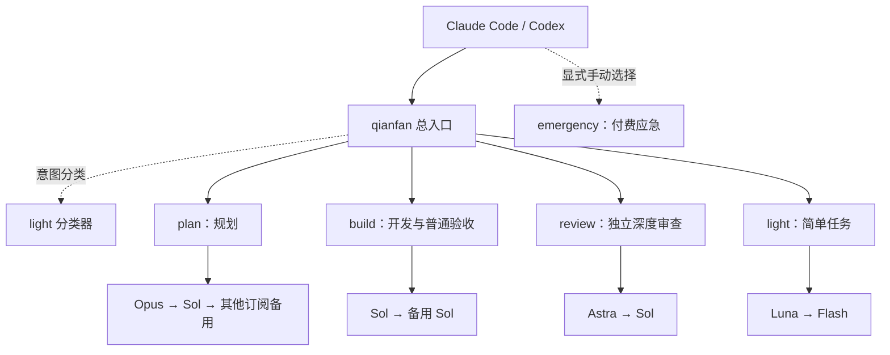

# Magpie 模型路由实践：按任务给 Claude Code 和 Codex 分配模型

## 使用背景

我是在推特上看到推荐后开始使用 Magpie 的。此前主要使用 Cockpits 管理账号，也尝试过 CC Switch。Cockpits 满足了我大部分账号管理需求，而 Magpie 更吸引我的是模型聚合与意图路由：可以根据任务选择模型，将账号和供应商的差异留在配置层处理。

- 官网：<https://usemagpie.ai>
- 代码仓库：[yetone/magpie](https://github.com/yetone/magpie)

CC Switch 则没有留下好的使用体验。它的 UI/UX 和操作组织都比较混乱，对我而言极其难用。虽然最近重构了 UI，但此前的体验已经让我失去继续尝试的意愿，新版也没有再用。这是我的使用评价。

我此前也尝试开发过 [Prismux](https://github.com/hiQianFan/prismux)，希望聚合各家的认证、登录和账号切换，后来放弃了继续维护。主要顾虑是维护成本：厂商的认证流程、凭据格式和令牌刷新机制经常变化，其中不少实现缺少公开说明。完成最初的接入之后，还需要长期跟踪这些变化，我无法持续投入这种强度的维护。

因此，这次选择 Magpie，除了账号管理，我更关注它能否减少工作中反复选择模型的操作。我的使用侧重点也随之变化：Cockpits 主要用于管理账号，Magpie 则用于组织不同模型的任务分工。这个区别来自我的实际需求，不是对两款工具功能范围的完整比较。

### 我的“贫民版”订阅组合

我的组合包括两个固定订阅、agy、按需补充的 GPT 临时账号，以及一个应急中转。整体费用如下。为便于比较，美元按 **1 美元约合 7 元人民币**粗略换算；临时账号的 10～30 暂按人民币计算。

| 项目 | 使用方式 | 计费方式 | 每月费用估算 |
| --- | --- | --- | --- |
| Claude | 1 个固定订阅 | 20 美元/月 | 约 140 元 |
| ChatGPT | 1 个固定订阅 | 20 美元/月 | 约 140 元 |
| Antigravity（agy） | 同时接入 Magpie | 按实际账号方案 | 按实际账单计入，暂未确定金额 |
| GPT 临时账号（日抛号） | 每月补充约 3～5 个，自己接码 | 约 10～30 元/个 | 约 30～150 元 |
| 应急中转 | 仅在需要时手动切换 | 按调用量计费 | 每月预留约 30～50 元 |
| **整体合计** | **固定订阅＋临时账号＋应急中转** | **另加 agy 实际费用** | **约 340～480 元/月＋agy 费用** |

按每月补充 3～5 个临时账号、为中转预留 30～50 元计算，整体预算约为 **340～480 元/月，另加 agy 的实际费用**。如果当月补充 N 个临时账号，则预算为 **310＋10N 至 330＋30N 元，再加 agy 费用**。中转预留金额不等于实际消耗，“日抛”也不代表每天购买一个账号。

因此，目前能确定的固定订阅支出是 **40 美元/月**，完整月费取决于其余项目的实际用量。额外接码费用、税费和支付手续费另计；VPS 等部署费用不属于这张模型使用费用表。上述换算用于预算，不是实时汇率或实际账单。

之前主要通过 Cockpits 管理这些账号，需要时手动来回切换。账号一多，额度和当前登录状态都需要自己关注；在我的这套用法里，也没有根据任务意图选择模型的路由，账号切换和模型选择是两项独立的手动操作。

现在我把这些账号聚合到 Magpie 中，再用任务组引用对应的模型来源。账号管理与模型路由由此集中在同一个入口：账号层维护登录和可用额度，路由层根据任务选择模型组。

另外，我保留了一个按量计费的中转服务作为紧急备用，单独放在 `qianfan-emergency` 组中，日常路由和分类器不引用它。需要应急时再手动切换，避免在已有订阅仍可用时产生额外的中转费用。

本文介绍目前使用的四组路由、意图规则、推理强度和客户端接入方式。配置记录截至 **2026-10-22**；Docker、HTTPS 和多设备共享另见[服务器部署实践](./Magpie%20服务器部署实践.md)。

## 1. 按任务职责划分路由组

目前的日常路由分为四组，分别对应规划、开发、审查和轻量任务：

| 路由组 | 职责范围 | 当前首选 |
| --- | --- | --- |
| plan | 需求讨论、规划、架构取舍、复杂方案评估 | Claude Opus |
| build | 实现、修复、调试、测试、普通检查与验收 | GPT Sol |
| review | 独立第二意见、安全、并发和数据一致性等深度审查 | GPT Astra |
| light | 独立简单任务、信息提取，同时承担分类和 compact | GPT Luna |

客户端引用固定组名，具体模型和账号在组内维护。这样，替换模型或调整供应商时，不需要逐个修改客户端配置。

review 的范围需要明确限制。构建检查、普通代码检查和按既定方案验收，都由 build 完成；review 用于独立第二意见，以及安全、并发、数据一致性等专项审查。这也是我调整过的一处规则：不能仅凭“检查”这个词就切换到审查模型。

light 的判断依据是任务复杂度和独立性，消息长度不足以决定分类。例如，“继续”可能承接一项复杂实现，需要结合前文处理。

## 2. 总入口与组内路由策略

日常入口 `qianfan` 引用四个子组。入口负责按意图选择任务组，各子组负责维护对应模型的优先顺序。

这里有三个不同层次：**意图分类**选择任务组，**组内路由**选择模型成员，**账号选择与轮换**处理该模型来源下的账号。多个账号聚合到同一个 provider，不等于增加了多个任务组，也不能据此认定所有配额场景都能自动接续。



组内使用 `routing=order`，按成员顺序尝试；它还受账号可用性、限额、错误类型和会话保持策略影响。把模型列在第二位，并不意味着任何错误都会无条件切过去，更不意味着切换后能力完全相同。

下面是我这次配置使用的模型成员，所有成员固定为 medium：

| 组 | 成员顺序 |
| --- | --- |
| plan | `claude/claude-opus-5-5:medium` → `codex/gpt-6.1-sol:medium` → `antigravity/claude-opus-4-6-thinking:medium` |
| build | `codex/gpt-6.1-sol:medium` → `codex/gpt-6-sol:medium` |
| review | `codex/gpt-6-astra:medium` → `codex/gpt-6.1-sol:medium` |
| light | `codex/gpt-6-luna:medium` → `antigravity/gemini-3.8-flash:medium` |

这些名称是本次环境中的模型目录记录，不代表其他账号一定有对应权限。建组前先运行 `magpie models`，确认本机实际提供的 ID。

以下 CLI 示例展示工作组的创建方式，实际操作可交给第 6 节的 Agent 配置流程：

```bash
magpie group add qianfan-build \
  models=codex/gpt-6.1-sol:medium,codex/gpt-6-sol:medium \
  routing=order stays=auto

magpie group add qianfan-review \
  models=codex/gpt-6-astra:medium,codex/gpt-6.1-sol:medium \
  routing=order stays=auto
```

同名组可能被替换，因此 Agent 应先检查已有配置并备份，再使用当前版本支持的命令操作。具体参数以 `magpie group --help` 为准。

## 3. 意图规则与分类边界

总入口按 review → build → light → plan 组织意图规则，另保留 compact 到 light 的规则。配置中的主要难点是处理职责重叠：普通验收与独立审查、规划与实现、简单提取与问题排查，需要通过包含条件和排除条件明确区分。

| 规则 | 包含 | 排除 |
| --- | --- | --- |
| review | 明确要求独立第二意见，或以安全、并发、数据一致性为目标的深度审查 | 普通实现、构建检查、按既定方案验收 |
| build | 写代码、修复、调试、重构、测试和普通检查 | 明确要求先规划再实现 |
| light | 独立解释、翻译、润色、指定范围的信息提取 | 排查与修复、依赖前文的承接请求 |
| plan | 需求、拆分、调度、架构和复杂方案取舍 | 普通编码、深度复核、仅说“继续” |

例如：

- “按刚才确定的方案实现，并跑构建”：build。
- “先比较两种方案，再开始开发”：先进入 plan。
- “独立检查这个事务有没有并发问题”：review。
- “把这段日志里的失败文件名提取出来”：light。
- “继续”：需要结合上下文，不能因为消息短就送往 light。

下面是总入口的结构示例，方便理解字段关系。它不是完整备份，不应直接覆盖整个 `providers.json`：

```json
{
  "id": "qianfan",
  "name": "qianfan",
  "members": [
    "group/qianfan-plan",
    "group/qianfan-build",
    "group/qianfan-review",
    "group/qianfan-light"
  ],
  "routing": "order",
  "classifier": "group/qianfan-light",
  "rules": [
    {
      "use": "group/qianfan-review",
      "intent": "明确要求独立第二意见或高风险深度审查；不含普通实现和常规验收"
    },
    {
      "use": "group/qianfan-build",
      "intent": "实现、修复、调试、测试及按既定方案验收；明确先规划再实现时不属于此类"
    },
    {
      "use": "group/qianfan-light",
      "intent": "独立简单解释或指定范围的信息提取；不含修复、排查或继续等承接请求"
    },
    {
      "use": "group/qianfan-plan",
      "intent": "需求、规划、架构取舍和复杂方案评估；包括明确先规划再实现"
    },
    {
      "use": "group/qianfan-light",
      "compact": true
    }
  ]
}
```

规则里的“继续不归 light”只是分类约束，**不能保证一定继承上轮选组**。是否保持原账号、在规划完成后是否切到开发组，仍需要结合实际请求和日志验证。

## 4. 分类器、上下文压缩与推理强度

意图分类器使用 light 组，以控制分类请求的资源开销。分类器本身也需要可用账号，并会产生额外调用与延迟，因此需要单独验证。

上下文压缩（compact）同样交给 light。验证时需要关注摘要是否保留用户约束、未完成事项和关键工具结果，可以通过压缩前后执行同一项约束检查进行对照。

早期配置中，light 使用 low，部分审查使用 high。后来我将所有成员统一为 medium，减少配置差异，便于观察模型分工和分类效果。这个选择尚未经过系统基准测试，不能据此认定 medium 在质量、延迟和成本上最优。

需要区分两层设置：

- 子代理的 `effort: medium` 或 `model_reasoning_effort = "medium"`，表达客户端请求的强度。
- 组成员的 `模型ID:medium`，固定这个成员实际使用的推理级别；模型不支持该级别时，具体行为依版本和模型能力而定。

如果成员仍固定为 `:low`，只改客户端 effort 不一定会达到预期。要统一强度，就需要同时检查客户端和远端组。

## 5. 订阅优先与手动付费应急

我希望优先使用已有订阅，付费中转仅用于应急。最初考虑在每组末尾追加付费模型，但组内回退无法表达“所有订阅均不可用”这一全局条件。

例如，review 的订阅暂不可用时，组内的付费备用就可能被调用，即使 build 仍有可用订阅。分类器若引用付费模型，也可能在正式任务开始前产生费用。

因此我的配置采用：

- 日常四组和分类器不引用付费中转。
- 独立建立 `qianfan-emergency`，使用 `routing=manual`。
- 需要时显式选中应急组，完成后切回日常入口。

```bash
magpie group add qianfan-emergency \
  models=relay/your-model:medium \
  routing=manual

magpie group pick qianfan-emergency relay/your-model:medium
```

`relay/your-model` 是占位符，需要替换成真实目录中的 ID。独立应急组没有实现“全局订阅全部失效后自动付费”的门控。如果付费 provider 的原始模型仍出现在目录中，手动选择它也会收费。

## 6. 通过 Magpie CLI 交给 Agent 配置

理解前面的分组与规则后，实际配置时，我建议不要逐项手动填写，也不要直接编辑 `providers.json`。先安装 Magpie CLI，把本文交给正在使用的 Agent，由它检查当前版本、模型目录和已有配置，再完成路由设置。文中的命令和 JSON 主要用于解释配置结构，便于检查 Agent 的执行结果。

CLI 的安装方式以 [Magpie 官网](https://usemagpie.ai)或[代码仓库](https://github.com/yetone/magpie)的当前说明为准。安装后，在 Agent 使用的终端里确认以下命令可用：

```bash
magpie --help
magpie models
magpie group --help
```

桌面应用能运行，不代表终端已经能找到 `magpie`。如果提示命令不存在，先完成 CLI 安装或 PATH 配置，再开始建组。

配置路由前，先在 Magpie 中完成所需账号或 provider 的授权，并确认模型目录可用。路由组只引用已有模型，不会自动获得订阅权限。仅在本地使用时，无需部署服务器或配置 Remote Magpie。

可以把文章链接或 Markdown 文件交给 Agent，并附上这样的要求：

```text
请参考这篇 Magpie 路由实践，为我配置模型路由组。

先读取 Magpie CLI 帮助、当前模型目录和已有路由配置，并备份将要修改的配置。
使用当前版本支持的 CLI 完成修改，不直接覆盖 providers.json，不输出密钥或账号令牌。

按 plan、build、review、light 划分任务，建立一个统一入口。
模型 ID 必须从我的实际目录中选择，不直接照抄文章；缺少的模型不要虚构。
各组成员优先使用 medium，意图规则参考文章中的职责边界。
如果已有付费中转，将其放入独立的手动 emergency 组，日常组与分类器不引用它。
不要为了配置路由新增账号、购买服务或修改登录凭据。

如果使用 Remote Magpie，先明确配置应落在本地还是远端，不要重复建立两套组。
完成后回读组配置、检查目录和客户端引用，并用小规模请求验证日常路由。
不要调用付费应急组进行测试。最后列出变更、验证结果和仍需我决定的事项。
```

配置完成后，再根据自己的使用习惯微调：规划优先哪个模型、审查是否需要独立模型、轻量任务包含哪些范围、是否保留备用成员。先用实际任务观察分类结果，再调整规则，比一次性写出很长的意图描述更容易判断效果。

## 7. 主会话与子代理的模型引用

创建路由组之后，还需要将客户端的主模型切换到总入口。只完成建组，不会自动让原本指定的单个模型开始使用意图路由。

本地使用时，Claude Code 和 Codex 的主模型选择 `group/qianfan`；使用 Remote Magpie 时，选择对应的 `remote/group/qianfan`。需要固定某类任务时，也可以直接选择子组。

本地组和远端组可能同名，但引用不同：

| 引用 | 含义 |
| --- | --- |
| `group/qianfan` | 本地 Magpie 的组 |
| `remote/group/qianfan` | 名为 remote 的 Remote Magpie provider 提供的组 |

`remote` 是设备本地的 provider 名称，可以自行命名。服务器不需要为了这个前缀再创建一套组。

以下是使用远端组的子代理示例；本地使用时，将 `remote/group/` 替换为 `group/`。子代理是可选配置，单独使用主会话路由不需要创建子代理。

Claude Code 子代理示例：

```yaml
---
name: task-builder
description: 按已确定的方案完成实现和验证。
model: remote/group/qianfan-build
effort: medium
---

先阅读项目规则，完成交付范围内的修改并报告验证结果。
```

Codex 子代理的对应字段是：

```toml
name = "task-builder"
description = "按已确定的方案完成实现和验证。"
model = "remote/group/qianfan-build"
model_reasoning_effort = "medium"
developer_instructions = "遵守项目规则，完成实现并验证。"
```

子代理配置语法取决于各自客户端版本。主会话选了远端，不代表子代理自动跟随。我这次清理本地组时，发现两个客户端的六个子代理仍在引用本地组；如果先删组，这些路径就会失效。

还有一个容易混淆的概念：Magpie 路由负责选择模型，子代理机制负责把任务交给另一段执行上下文。切换模型本身并不等于创建了独立审查者，也不会自动实现多代理协作。

## 8. 路由验证与实际使用结果

配置完成后，应分别检查保存结果、客户端接入和实际路由。下面是验证清单，各项的实际完成情况还需以调用结果为准：

| 验证层次 | 检查内容 |
| --- | --- |
| 配置 | 组成员存在，引用没有环，规则和强度保存正确 |
| 目录 | 网关能列出预期组，客户端能选到它 |
| 生成 | 实际请求成功，包含预期内容 |
| 路由 | 代表性任务命中了预期组、模型与账号 |
| 连续使用 | 多轮、compact、限额和故障后的行为符合预期 |

本次迁移后，本地只保留远端连接，目录里有六个远端组、没有本地组。通过本地网关调用远端 light 返回 HTTP 200、内容 `OK`，模型为 GPT Luna。这证明了该次请求链路可用，不能代替其余组、工具调用和长对话的完整验收。

后续验证可以使用固定任务样本，覆盖规划、实现、独立审查和信息提取，再追加“继续”“开始实现”等承接请求。记录实际命中的组、模型和误分类情况，以具体样本作为调整规则的依据。

## 9. 后续观察

当前保留这四个任务组，后续主要观察分类准确性、多轮承接和压缩后的约束保留，以及订阅限额触发时的回退行为。这几项会直接影响日常使用，也需要比单次调用更长的观察周期。

对我来说，引入这套路由的目的是减少不同任务之间的手动模型切换。如果单一模型已经满足需求，就没有必要照搬全部分组；分类器和备用模型同样会增加调用与维护成本。

## 参考与后续阅读

- [Magpie 官网](https://usemagpie.ai)
- [Magpie 代码仓库](https://github.com/yetone/magpie)
- [Magpie 服务器部署实践](./Magpie%20服务器部署实践.md)
- [Code Agent 项目的上下文文件设计指南](./Code%20Agent%20项目的上下文文件设计指南.md)

本文命令依据本次使用版本的帮助输出整理；迁移到其他版本前，先核对 `magpie group --help`、`magpie models` 和客户端的子代理配置格式。
